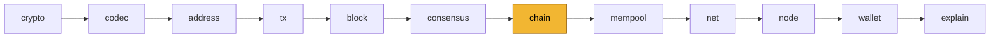

<div align="center">


# minicoin

**Минимальная, но настоящая криптовалюта. Код читается за вечер.**<br>
Три независимые реализации одного протокола — на Rust, Python и Go — в одной сети.

[](https://github.com/AlexMelanFromRingo/minicoin/actions/workflows/ci.yml)


[](LICENSE)

[Что внутри](#-что-внутри) ·
[Порядок чтения](#-порядок-чтения) ·
[Запуск](#-запуск) ·
[Протокол](PROTOCOL.md) ·
[Векторы](vectors.txt)

</div>

---

Сеть работает по-настоящему: узлы находят друг друга, майнят,
синхронизируются, переживают форки, а кошельки переводят монеты. При этом
всё, что и есть криптовалюта, — формат байтов, UTXO, валидация, PoW,
сложность, сеть — написано здесь. Из библиотек взяты только хеш и подпись.

|  | 🦀 Rust (`rust/`) | 🐍 Python (`python/`) | 🐹 Go (`go/`) |
|---|---|---|---|
| Размер (без тестов) | ≈ 2 300 строк | ≈ 1 850 строк | ≈ 2 850 строк |
| Зависимости | `blake3`, `ed25519-dalek`, `getrandom` | `blake3`, `pynacl` | `lukechampine.com/blake3` (Ed25519 — из стандартной библиотеки) |
| Тесты | 37 | 22 | 39 |

Реализации совместимы байт в байт: блок, найденный Python-майнером,
принимает Rust-узел, блок Go-майнера — оба других, и наоборот. Это проверяют
общие векторы [vectors.txt](vectors.txt), и в CI все три реализации сверяются
с ними.

## 🧩 Что внутри

| | |
|---|---|
| 💰 **UTXO** | Монеты — непотраченные выходы, баланс — их сумма. |
| ✍️ **Подписи Ed25519** | Выход запирается открытым ключом, вход отпирается подписью. Скриптов нет. |
| ⛏️ **Proof of Work на BLAKE3** | `hash(header) ≤ (2²⁵⁶ − 1) / difficulty`. |
| 📈 **Сложность** | Пересчёт каждые 20 блоков, не больше чем в 4 раза за раз. |
| 🌳 **Выбор цепи и реорганизации** | Побеждает наибольшая суммарная работа; UTXO откатываются по undo-данным. |
| 🪙 **Эмиссия** | 50 монет за блок, халвинг каждые 100 000 блоков, награда созревает 10 блоков. |
| ⏳ **Срок действия транзакции** | `expiry_height`: платёж не зависает навсегда. |
| 📬 **Мемпул и RBF** | Минимальная комиссия, выбор по комиссии за байт, замена застрявших платежей. |
| 🌐 **P2P по TCP** | Синхронизация через локатор, рассылка блоков и транзакций. |
| 🔤 **Адреса Bech32m** `mc1…` | Контрольная сумма ловит опечатки. |
| 🔬 **`explain`** | Побайтовый разбор любого блока, как на [learnmeabitcoin](https://learnmeabitcoin.com/). |

Чего нет специально: скриптов, мультиподписи, HD-кошельков, SPV, шифрования
кошелька, цепочек неподтверждённых транзакций, защиты от DoS. Каждое из
этого — следующая глава, а не основа.

> [!CAUTION]
> **minicoin — для чтения и экспериментов, не для настоящих денег.** Пример
> того, чего не хватает: узел хранит любую боковую ветку с правильным PoW.
> Сложность у генезиса низкая, поэтому злоумышленник может дёшево намайнить
> тысячи блоков, ответвлённых от самого начала цепи, и забить узлу память и
> диск. Настоящие сети защищаются чекпоинтами и порогом минимальной работы
> цепи. Ключ кошелька тоже хранится незашифрованным (файл доступен только
> владельцу, `0600`).
>
> Подпись покрывает суммы тратимых выходов, поэтому чужой узел не заставит кошелёк переплатить комиссию ([PROTOCOL.md](PROTOCOL.md), §1).

## 📖 Порядок чтения



Файлы в `rust/src/`, `python/minicoin/` и `go/` называются одинаково и
устроены одинаково, их удобно читать параллельно. Самое главное — `chain`: правила
траты (`check_tx`), применение блока и реорганизация.

## 🚀 Запуск

```bash
# Rust
cd rust && cargo build --release
alias mc=./target/release/minicoin

# или Python
cd python && uv venv && uv pip install -e .
alias mc="python -m minicoin"

# или Go
cd go && go build ./cmd/minicoin
alias mc=./minicoin
```

Сеть из двух узлов на одной машине:

```bash
mc new-wallet --wallet alice.key
mc new-wallet --wallet bob.key

mc node --port 4242 --data a --mine --wallet alice.key          # терминал 1
mc node --port 4243 --data b --peer 127.0.0.1:4242              # терминал 2

mc info                                                         # высота, сложность, мемпул
mc balance --wallet alice.key                                   # через 10 блоков награды созреют
mc send $(mc address --wallet bob.key) 12.5 --wallet alice.key --node 127.0.0.1:4243
mc balance --wallet bob.key
mc bump <txid> --wallet alice.key                               # поднять комиссию, если платёж застрял
mc explain 1                                                    # разобрать блок по байтам
```

> [!TIP]
> **Как увидеть реорганизацию.** Запустите третий узел с майнингом без
> `--peer`, дайте ему добыть несколько блоков, остановите и перезапустите с
> `--peer 127.0.0.1:4242`. Его ветка проиграет по работе и откатится — в логе
> будет `РЕОРГАНИЗАЦИЯ`.

## 🔁 Замена транзакций (replace-by-fee)

Если транзакция застряла с маленькой комиссией, её можно заменить другой,
которая тратит те же входы (`should_replace` в `mempool`). Замена принимается,
если выполнены оба условия:

1. она платит всё, что платили вытесняемые, плюс свою ретрансляцию
   (`MIN_FEE_RATE × размер`), иначе сеть можно бесплатно засыпать заменами;
2. её комиссия за байт строго выше, иначе мемпул станет хуже для майнера.

Из кошелька это делает `bump`: он берёт застрявшую транзакцию у узла
(`GetMempoolTx`), сверяет суммы её входов с подписями и сам считает старую
комиссию, оставляет те же входы и того же получателя, а прибавку к
комиссии вычитает из сдачи. По умолчанию комиссия удваивается, но не меньше
минимума по правилу выше.

```bash
mc send <адрес> 3 --fee 0.000002          # слишком дёшево — ждёт
mc bump <txid>                            # 0.00000200 → 0.00000400, старая вытеснена
```

## 🧪 Тесты

```bash
cd rust && cargo test            # 37 тестов
cd python && pytest              # 22 теста, включая сверку с vectors.txt
cd go && go test ./...           # 39 тестов, включая сверку с vectors.txt
```

## Что дальше

Полноценная сеть по тем же идеям, но с RandomX, постквантовыми подписями,
ASERT, HD-кошельком, compact blocks, фаззингом и пакетом для аудита — **Sceat**.

## Лицензия

[MIT](LICENSE) © 2026 Alex Melan
